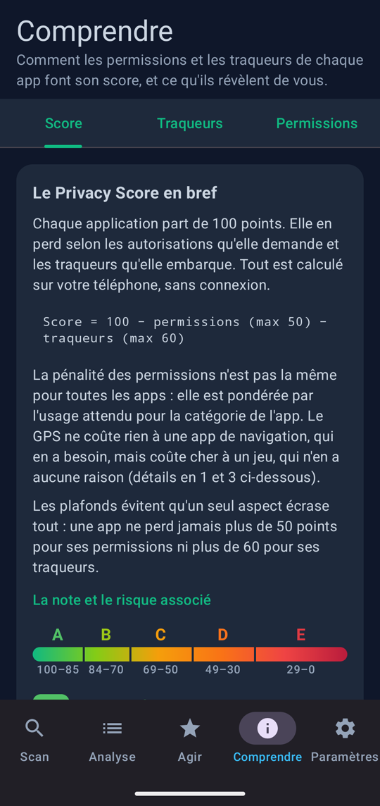
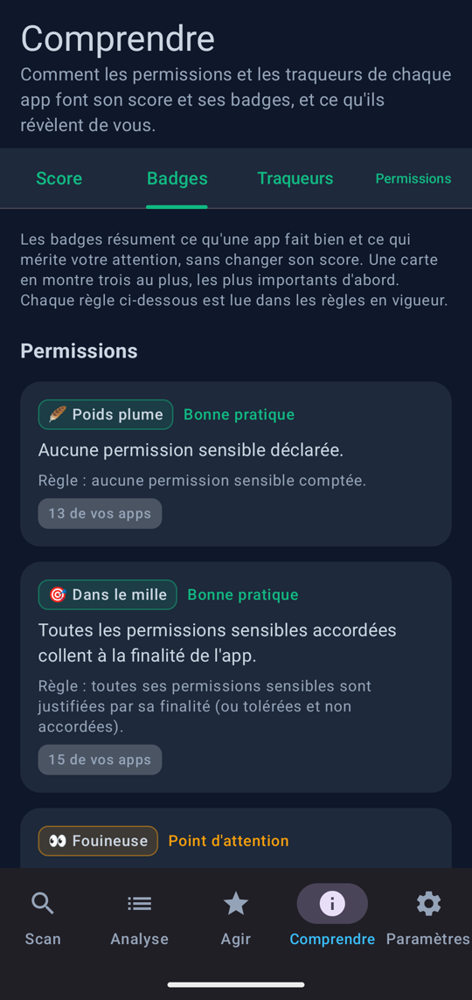
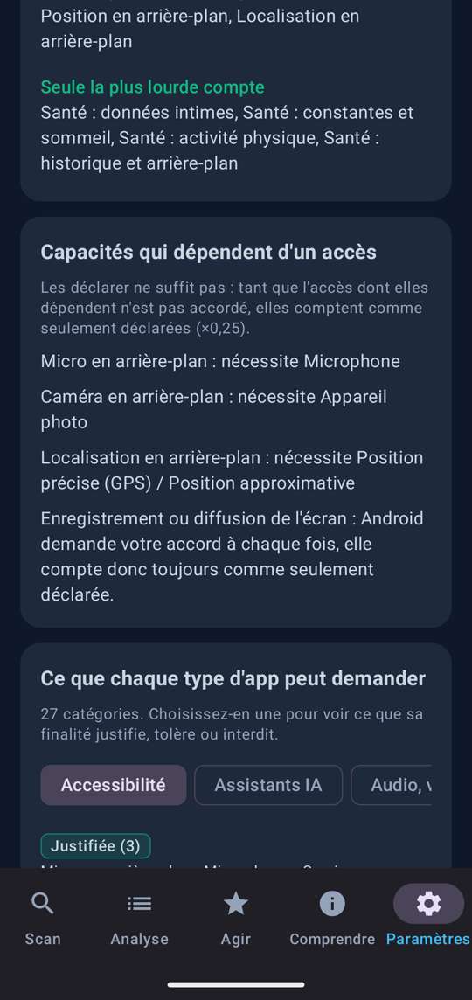
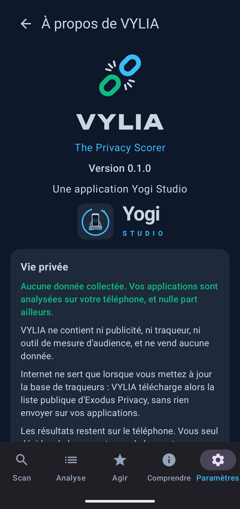

# VYLIA

**The Privacy Scorer : l'audit de confidentialité de vos applications Android, 100 % sur le téléphone.** Une application
de [Yogi Studio](#crédits) qui note chaque app installée de 0 à 100 selon les permissions qu'elle demande et les
traqueurs qu'elle embarque, explique pourquoi, et aide à faire le ménage.

**L'idée de départ : être le Yuka de la vie privée.** Comme on scanne un produit pour savoir ce qu'il contient, VYLIA
scanne vos applications pour savoir ce qu'elles font de vos données. Le but est de mettre à la portée de tous une
compréhension simple des enjeux de vie privée : une note lisible, des explications sans jargon, des bonnes pratiques
mises en avant autant que les dérives, et des gestes concrets pour reprendre la main.

> Version actuelle : **0.8.1** ([télécharger l'APK](https://github.com/GuillaumeCHR/VYLIA/releases/latest)).
> Identifiant : `com.vylia.privacy`. Android 8.0 (API 26) et plus. Anglais par défaut, français disponible dans
> Paramètres › Langue.

## Aperçu

| | | | |
|:---:|:---:|:---:|:---:|
|  |  |  |  |
| Comprendre | Les badges et leurs règles | Grille de score | À propos |

## Ce qu'elle fait

- **Un score par app, de 0 à 100, et une note de A à E** : on part de 100, on retire les permissions (50 points au
  plus) et les traqueurs (60 points au plus).
- **Des permissions jugées selon la finalité de l'app** : le GPS ne coûte rien à une app de navigation, il coûte cher à
  un jeu. Chacune des 28 catégories (navigation, messagerie, banque, jeux, santé…) dit ce qu'elle justifie, tolère ou
  interdit.
- **Des traqueurs détectés localement** : VYLIA cherche dans le code de chaque app les signatures de la base publique
  [Exodus Privacy](https://exodus-privacy.eu.org/), sans rien envoyer.
- **Des badges qui qualifient, sans alarmer** : bonnes pratiques (« Poids plume », « Bio », « Sait se faire oublier »)
  autant que points d'attention (« Fouineuse », « Régie publicitaire », « Moteur, ça tourne ! »).
- **Des capacités d'espionnage repérées** : clavier ou service d'accessibilité capable de lire la saisie, icône cachée
  avec accès sensibles, lecture d'écran avec superposition. Elles plafonnent le score.
- **Toutes les permissions, comme sur Exodus** : regroupées par thème, avec leur niveau de protection Android et une
  fiche en langage simple pour comprendre chacune.
- **Trois vues de vos apps** : par risque, par catégorie, par badge. Un toucher sur l'icône ouvre la fiche Android de
  l'app pour la désinstaller ou retirer une autorisation.
- **Agir** : les pires élèves à désinstaller, les meilleures apps à garder, des points et des trophées pour chaque
  app intrusive supprimée, un bilan à partager.
- **Comprendre** : le calcul du score, les badges, le lexique des traqueurs et celui des permissions, avec ce que
  chacun révèle de vous et combien de vos apps sont concernées ; une loupe pour chercher dans chaque onglet.
- **DNS privé** : un guide pour chiffrer les requêtes DNS de tout le téléphone (Quad9 recommandé, ou NextDNS), avec
  l'état actuel, les étapes dans les réglages Android et comment revenir en arrière.
- **Suivi** : la courbe de votre score moyen dans le temps, les apps qui pèsent le plus, l'historique des
  installations, suppressions et autorisations.
- **Automatisations** (désactivées par défaut) : une notification à l'installation d'une app avec son score, et des
  scans de fond hebdomadaires ou mensuels qui alimentent le Suivi.
- **Vos données, à vous** : exporter tout ce que VYLIA conserve dans un fichier lisible, l'importer sur un autre
  téléphone sans rien écraser, ou tout supprimer.

## Une grille de score transparente

La grille complète (poids de chaque permission, groupes, contexte par catégorie, permissions volontairement non
comptées) est consultable dans l'app, **Paramètres › Règles de score › Voir la grille**, et dans
[`app/src/main/assets/vylia_rules_v3.json`](app/src/main/assets/vylia_rules_v3.json). Quelques principes :

- une capacité d'arrière-plan (micro, caméra, position) ne compte entièrement que si l'accès dont elle dépend est
  accordé ; la capture d'écran, soumise à votre accord à chaque fois, compte comme seulement déclarée ;
- les permissions de ciblage publicitaire ne sont pas comptées : la publicité est déjà sanctionnée par les traqueurs ;
- des permissions proches ne comptent qu'une fois (position précise et approximative, paliers de santé…).

**VYLIA se note elle-même**, avec la même grille et sans exception. Elle a besoin de la liste de vos apps
(`QUERY_ALL_PACKAGES`) pour les analyser : elle l'assume, et cette permission lui coûte des points comme à n'importe
quelle app.

Les règles peuvent être remplacées par un fichier importé (Paramètres › Règles de score), qui est vérifié avant usage
et ne peut exclure aucune app de l'audit. Leur évolution est documentée dans [`docs/scoring/`](docs/scoring/).

## Vie privée

**Aucune donnée collectée. Vos applications sont analysées sur votre téléphone, et nulle part ailleurs.**

- Aucune publicité, aucun traqueur, aucun outil de mesure d'audience, aucune donnée revendue.
- Internet ne sert que lorsque vous mettez à jour la base de traqueurs : VYLIA télécharge alors la liste publique
  d'Exodus Privacy, sans rien envoyer sur vos applications.
- Les résultats, badges et points restent sur le téléphone et sont exclus des sauvegardes Android. L'export, l'import
  et le partage du bilan ne se font qu'à votre demande.
- Les alertes d'installation et les scans de fond, désactivés par défaut, s'exécutent sur le téléphone uniquement.
- Tout ce qui vient de l'extérieur (sauvegarde importée, règles importées, base Exodus téléchargée) est vérifié avant
  usage : voir [`docs/security/donnees-externes.md`](docs/security/donnees-externes.md).

## Installer

Téléchargez le fichier `vylia-X.Y.Z.apk` de la dernière version depuis la [page des versions](https://github.com/GuillaumeCHR/VYLIA/releases/latest),
puis ouvrez-le sur le téléphone (Android demande d'autoriser l'installation depuis cette source). Empreinte SHA-256 du
certificat de signature, pour vérifier l'APK avec `apksigner verify --print-certs` :

```
7f62c73f7ba255eb7de02e40beb22640fd8e9c6f22375d3663d70f6271516c89
```

## Construire et lancer

Prérequis : JDK 17 ou plus récent et le SDK Android avec la plateforme `android-37` (`sdk.dir` dans
`local.properties`). Le wrapper Gradle télécharge le reste.

```bash
./gradlew :app:assembleDebug        # APK : app/build/outputs/apk/debug/app-debug.apk
./gradlew :app:testDebugUnitTest    # tests unitaires (score, badges, lexiques, analyse des traqueurs…)
./gradlew :app:lintDebug            # lint Android
./gradlew :app:assembleRelease      # APK release minifié, signé si la clé locale est présente
```

La clé de signature release n'est jamais dans le dépôt : ses coordonnées sont lues dans
`~/.config/vylia/release-key.properties` (ou le fichier désigné par `VYLIA_RELEASE_KEY_PROPERTIES`). Sans elle, la
release est construite sans signature. Pour essayer une release sur un téléphone qui a déjà la version de
développement : `./gradlew :app:assembleRelease -Pvylia.idSuffix=.releasetest`.

La version de développement écrit le score de chaque app dans le journal, pour comparer deux versions des règles sur
un vrai téléphone : `adb logcat -s VyliaScores`.

## Architecture

Application mono-module en Kotlin et Jetpack Compose (Material 3), sans framework d'injection (conteneur manuel dans
`di/AppContainer.kt`).

```
app/src/main/java/com/vylia/privacy/
├── data/         apps installées et signaux de sécurité (apps/), analyse DEX des traqueurs (trackers/),
│                 règles de score (rules/), suivi (history/), tâches de fond (automation/),
│                 sauvegarde (backup/), préférences, récompenses, export CSV
├── domain/       moteur de score et badges (scoring/), lexiques (learn/), analyse de l'appareil, suivi,
│                 sauvegarde et contrôles des données externes (backup/, security/), modèles
└── ui/           un paquet par écran : scan/, analysis/, act/, understand/, settings/, detail/ ;
                  main/ (navigation), splash/ (intro), components/, theme/
```

- **Score** : `domain/scoring/PrivacyScorer.kt` applique les règles JSON ; `BadgeEngine.kt` attribue les badges ;
  `SecurityPatternDetector.kt` évalue les motifs de capacités d'espionnage.
- **Traqueurs** : `data/trackers/` lit les noms de classes des fichiers DEX en flux et les compare aux signatures
  Exodus (`assets/exodus_trackers.json`), avec un cache par version d'app.
- **Textes** : anglais par défaut, français dans `values-fr`, générés par [`tools/strings/`](tools/README.md).

Outils du dépôt : voir [`tools/README.md`](tools/README.md). Feuille de route : [`docs/roadmap.md`](docs/roadmap.md).

## Crédits

- **Édition, conception et développement** : Yogi Studio. Le générique complet, avec un peu d'humour, est à la fin
  de l'écran À propos.
- **Programmation en binôme** : Claude (Anthropic), via Claude Code.
- **Signatures de traqueurs** : [Exodus Privacy](https://exodus-privacy.eu.org/), base sous
  [Open Database License (ODbL 1.0)](https://opendatacommons.org/licenses/odbl/1-0/), contenus sous Database Contents
  License (DbCL 1.0). Logo Exodus Privacy repris de [exodus-android-app](https://github.com/Exodus-Privacy/exodus-android-app)
  (GPL v3). VYLIA est une application indépendante, ni affiliée à Exodus Privacy ni approuvée par elle.
- **Police du nom VYLIA** : [Unbounded](https://github.com/googlefonts/unbounded), The Unbounded Project Authors,
  SIL Open Font License 1.1.

## Licence

VYLIA est un logiciel libre, sous licence [GNU GPL v3](LICENSE) ou toute version ultérieure : vous pouvez l'étudier,
le modifier et le redistribuer selon ses termes. Il est fourni sans aucune garantie.

Les noms VYLIA et Yogi Studio, leurs logos et l'icône de l'application ne sont pas couverts par la licence.

## Contact

Un bug, une idée, une question : yogistudiofr@gmail.com.
