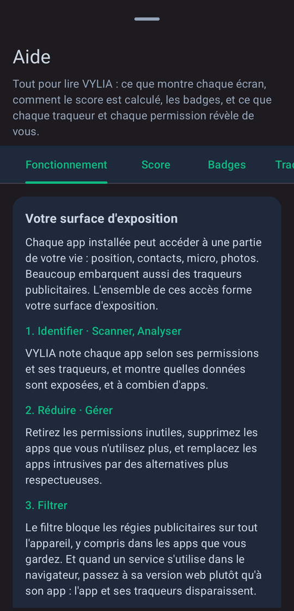
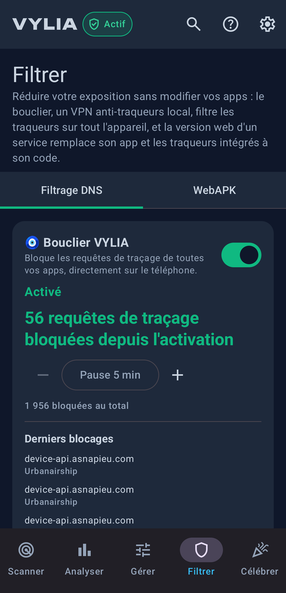
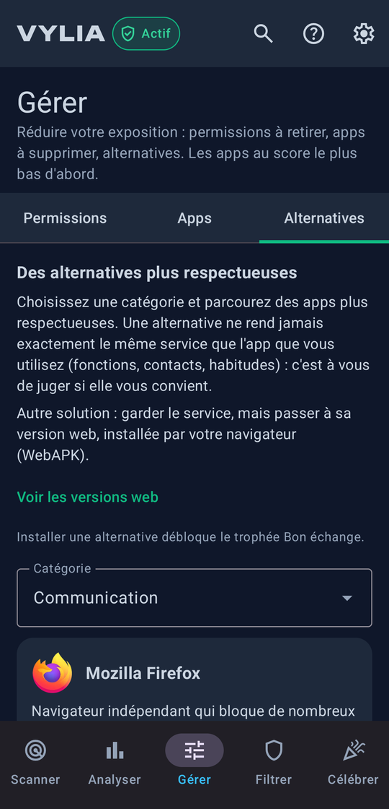
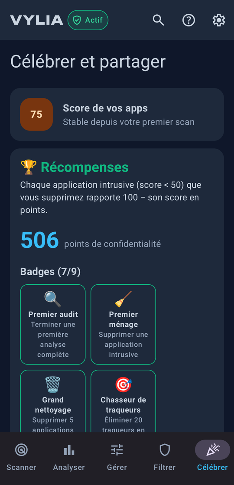

# VYLIA : privacy score & manager

**Notez, réduisez et filtrez ce que vos applications Android savent de vous, 100 % sur le téléphone.** Une
application de [Yogi Studio](#crédits) qui note chaque app installée de 0 à 100 selon les permissions qu'elle demande
et les traqueurs qu'elle embarque, explique pourquoi, aide à faire le ménage et bloque les régies publicitaires sur
tout l'appareil.

**L'idée de départ : être le Yuka de la vie privée.** Comme on scanne un produit pour savoir ce qu'il contient, VYLIA
scanne vos applications pour savoir ce qu'elles font de vos données. Le but est de mettre à la portée de tous une
compréhension simple des enjeux de vie privée : une note lisible, des explications sans jargon, des bonnes pratiques
mises en avant autant que les dérives, et des gestes concrets pour reprendre la main.

> Version actuelle : **0.9.0** ([télécharger l'APK](https://github.com/GuillaumeCHR/VYLIA/releases/latest)) ·
> site : [guillaumechr.github.io/vylia-site](https://guillaumechr.github.io/vylia-site/).
> Identifiant : `com.vylia.privacy`. Android 8.0 (API 26) et plus. Anglais par défaut, français disponible dans
> Paramètres › Langue.

## Aperçu

| | | | |
|:---:|:---:|:---:|:---:|
|  |  |  |  |
| Comment fonctionne VYLIA | Filtrer | Alternatives | Célébrer et partager |

## Comment ça marche

Chaque app installée peut accéder à une partie de votre vie : position, contacts, micro, photos, et beaucoup
embarquent des traqueurs publicitaires. L'ensemble forme votre **surface d'exposition**. VYLIA la traite en cinq écrans,
dans l'ordre de la barre du bas :

1. **Scanner** : un score par app, de 0 à 100, et une note de A à E. On part de 100, on retire les permissions
   (50 points au plus) et les traqueurs (60 points au plus). Trois vues : par risque, par catégorie, par badge ; des
   cartes compactes ou détaillées ; un toucher sur l'icône ouvre la fiche Android de l'app.
2. **Analyser** : les zones de risque, les anomalies et les traqueurs les plus répandus sur le téléphone ; le **Suivi**
   avec la courbe du score dans le temps, l'historique des installations, suppressions et autorisations, et une
   **alerte de seuil** si votre exposition augmente.
3. **Gérer** : réduire l'exposition.
   - **Permissions** : une carte par app, les scores les plus bas d'abord, avec les permissions dont elle se sert sans
     en avoir besoin, le gain de chacune et le score qu'elle atteindrait sans elles.
   - **Apps** : les apps intrusives et celles que vous n'ouvrez plus.
   - **Alternatives** : des apps plus respectueuses par catégorie du Play Store, avec leur note Google Play. Aucune ne
     rend exactement le même service : c'est à vous de choisir.
4. **Filtrer** : réduire l'exposition sans modifier vos apps.
   - **Filtrage DNS** : le **bouclier VYLIA**, un VPN local qui répond « introuvable » aux domaines des régies et des
     traqueurs, sur tout l'appareil et y compris dans les apps que vous gardez (filtrage web et mobile au choix, pause,
     compteur en direct, tuile des réglages rapides). Ou le **DNS privé** d'Android, avec un guide pas à pas (NextDNS
     pour bloquer les traqueurs, Quad9 sans compte).
   - **WebAPK** : remplacer une app par la version web du même service, installée par le navigateur comme une app.
     L'app native, ses permissions et les traqueurs de son code disparaissent. VYLIA repère vos apps qui ont un site
     d'après les adresses web qu'elles déclarent à Android, dans les catégories où un site peut les remplacer.
5. **Célébrer et partager** : le score du téléphone, vos progrès, des points et des badges pour chaque app intrusive
   supprimée, et une image à partager (score, progrès, traqueurs, bouclier, trophées) qui ne montre jamais le nom d'une
   app.

Et aussi :

- **Des permissions jugées selon la finalité de l'app** : le GPS ne coûte rien à une app de navigation, il coûte cher à
  un jeu. Chacune des 28 catégories (navigation, messagerie, banque, jeux, santé…) dit ce qu'elle justifie, tolère ou
  interdit.
- **Des traqueurs détectés localement** : VYLIA cherche dans le code de chaque app les signatures de la base publique
  [Exodus Privacy](https://exodus-privacy.eu.org/), sans rien envoyer.
- **Des logiciels espions repérés** : la base publique de l'association [Echap](https://echap.eu.org/) (stalkerwares,
  pour espionner un proche) et les indicateurs de [MVT](https://github.com/mvt-project/mvt-indicators) (logiciels
  espions de surveillance ciblée comme Pegasus, Predator ou NoviSpy) sont intégrés ; une app reconnue tombe à 0 et
  déclenche une alerte, avec des conseils adaptés. Le bouclier bloque aussi les domaines de ces campagnes.
- **Des capacités d'espionnage repérées** : clavier ou service d'accessibilité capable de lire la saisie, icône cachée
  avec accès sensibles, lecture d'écran avec superposition. Elles plafonnent le score.
- **Des badges qui qualifient, sans alarmer** : bonnes pratiques (« Poids plume », « Bio », « Sait se faire oublier »)
  autant que points d'attention (« Fouineuse », « Régie publicitaire », « Moteur, ça tourne ! »).
- **Une aide unique**, la même depuis chaque écran : comment fonctionne VYLIA, le calcul du score, les badges, le
  lexique des traqueurs et celui des permissions.
- **Automatisations** (désactivées par défaut) : une notification à l'installation d'une app avec son score, et des
  scans de fond hebdomadaires ou mensuels qui alimentent le Suivi.
- **Vos données, à vous** : exporter tout ce que VYLIA conserve dans un fichier lisible, l'importer sur un autre
  téléphone sans rien écraser, ou tout supprimer.

## Une grille de score transparente

La grille complète (poids de chaque permission, groupes, contexte par catégorie, permissions volontairement non
comptées) est consultable dans l'app, **Aide › Score › La grille, catégorie par catégorie**, et dans
[`app/src/main/assets/vylia_rules_v3.json`](app/src/main/assets/vylia_rules_v3.json). Quelques principes :

- une capacité d'arrière-plan (micro, caméra, position) ne compte entièrement que si l'accès dont elle dépend est
  accordé ; la capture d'écran, soumise à votre accord à chaque fois, compte comme seulement déclarée ;
- les permissions de ciblage publicitaire ne sont pas comptées : la publicité est déjà sanctionnée par les traqueurs ;
- des permissions proches ne comptent qu'une fois (position précise et approximative, paliers de santé…).

**VYLIA se note elle-même**, avec la même grille et sans exception. Elle a besoin de la liste de vos apps
(`QUERY_ALL_PACKAGES`) pour les analyser : elle l'assume, et cette permission lui coûte des points comme à n'importe
quelle app.

Les règles peuvent être remplacées par un fichier importé (Paramètres › Règles de score), qui est vérifié avant usage
et ne peut exclure aucune app de l'audit. Leur évolution est documentée dans [`docs/scoring/`](docs/scoring/).

## Vie privée

**Aucune donnée collectée. Vos applications sont analysées sur votre téléphone, et nulle part ailleurs.**
Politique complète : [confidentialité](https://guillaumechr.github.io/vylia-site/fr/confidentialite.html) ·
[conditions d'utilisation](https://guillaumechr.github.io/vylia-site/fr/conditions.html).

- Aucune publicité, aucun traqueur, aucun outil de mesure d'audience, aucune donnée revendue.
- Internet ne sert qu'à vos demandes de mise à jour : la base de traqueurs d'Exodus Privacy, celle des stalkerwares
  d'Echap et la liste des DNS privés. Ce sont des fichiers publics téléchargés tels quels : rien n'est envoyé sur vos
  applications.
- Le bouclier filtre sur le téléphone. Les requêtes qu'il laisse passer vont directement au DNS de votre réseau, comme
  sans lui : aucun serveur de VYLIA, aucun journal des sites visités.
- Les résultats, badges et points restent sur le téléphone et sont exclus des sauvegardes Android. L'export, l'import
  et le partage du bilan ne se font qu'à votre demande.
- Les alertes d'installation et les scans de fond, désactivés par défaut, s'exécutent sur le téléphone uniquement.
- Tout ce qui vient de l'extérieur (sauvegarde importée, règles importées, bases téléchargées) est vérifié avant
  usage : voir [`docs/security/donnees-externes.md`](docs/security/donnees-externes.md).

## Installer

Téléchargez le fichier `vylia-X.Y.Z.apk` de la dernière version depuis la [page des versions](https://github.com/GuillaumeCHR/VYLIA/releases/latest),
puis ouvrez-le sur le téléphone (Android demande d'autoriser l'installation depuis cette source). Empreinte SHA-256 du
certificat de signature, pour vérifier l'APK avec `apksigner verify --print-certs` :

```
7f62c73f7ba255eb7de02e40beb22640fd8e9c6f22375d3663d70f6271516c89
```

## Construire et lancer

Prérequis : JDK 17 ou plus récent et le SDK Android avec la plateforme `android-37` (`sdk.dir` dans
`local.properties`). Le wrapper Gradle télécharge le reste.

```bash
./gradlew :app:assembleDebug        # APK : app/build/outputs/apk/debug/app-debug.apk
./gradlew :app:testDebugUnitTest    # tests unitaires (score, badges, lexiques, analyse des traqueurs…)
./gradlew :app:lintDebug            # lint Android
./gradlew :app:assembleRelease      # APK release minifié, signé si la clé locale est présente
```

La clé de signature release n'est jamais dans le dépôt : ses coordonnées sont lues dans
`~/.config/vylia/release-key.properties` (ou le fichier désigné par `VYLIA_RELEASE_KEY_PROPERTIES`). Sans elle, la
release est construite sans signature. Pour essayer une release sur un téléphone qui a déjà la version de
développement : `./gradlew :app:assembleRelease -Pvylia.idSuffix=.releasetest`.

La version de développement écrit le score de chaque app dans le journal, pour comparer deux versions des règles sur
un vrai téléphone : `adb logcat -s VyliaScores`.

## Architecture

Application en Kotlin et Jetpack Compose (Material 3), sans framework d'injection (conteneur manuel dans
`di/AppContainer.kt`), en deux modules : `:app` et `:shield`, le bouclier (VPN local de filtrage DNS, voir
[`docs/shield.md`](docs/shield.md)). Sans `:shield` (`SHIELD_ENABLED` à `false`), Filtrer garde le DNS privé et le WebAPK.

```
app/src/main/java/com/vylia/privacy/
├── data/         apps installées et signaux de sécurité (apps/), analyse DEX des traqueurs (trackers/),
│                 règles de score (rules/), suivi (history/), tâches de fond (automation/),
│                 sauvegarde (backup/), sites des apps (web/), préférences, récompenses, export CSV
├── domain/       moteur de score et badges (scoring/), lexiques (learn/), gérer et alternatives (act/),
│                 versions web (web/), analyse de l'appareil, suivi, contrôles des données externes
└── ui/           scan/, analysis/, act/ (Gérer, Filtrer, Célébrer), help/ et understand/ (aide), settings/,
                  detail/, share/, search/, shield/ ; main/ (navigation), splash/ (intro), components/, theme/
```

- **Score** : `domain/scoring/PrivacyScorer.kt` applique les règles JSON ; `BadgeEngine.kt` attribue les badges ;
  `SecurityPatternDetector.kt` évalue les motifs de capacités d'espionnage.
- **Traqueurs** : `data/trackers/` lit les noms de classes des fichiers DEX en flux et les compare aux signatures
  Exodus (`assets/exodus_trackers.json`), avec un cache par version d'app.
- **Textes** : anglais par défaut, français dans `values-fr`, générés par [`tools/strings/`](tools/README.md).

Outils du dépôt : voir [`tools/README.md`](tools/README.md). Feuille de route : [`docs/roadmap.md`](docs/roadmap.md).

## Crédits

- **Édition, conception et développement** : Yogi Studio. Le générique complet, avec un peu d'humour, est à la fin
  de l'écran À propos.
- **Programmation en binôme** : Claude (Anthropic), via Claude Code.
- **Stalkerwares connus** : [Echap](https://echap.eu.org/), base
  [stalkerware-indicators](https://github.com/AssoEchap/stalkerware-indicators) sous licence
  [CC BY 4.0](https://creativecommons.org/licenses/by/4.0/) (extrait adapté : noms, paquets et certificats).
- **Logiciels espions de surveillance ciblée** : [MVT, mvt-indicators](https://github.com/mvt-project/mvt-indicators)
  (licence MIT), avec les indicateurs publiés par Amnesty International, Citizen Lab, Google, Lookout et d'autres
  chercheurs (extrait : noms de paquet, certificats et domaines, voir [`tools/update_mvt_iocs.py`](tools/update_mvt_iocs.py)).
- **Alternatives** : classement d'après les recommandations de la communauté [AlternativeTo](https://alternativeto.net/),
  notes relevées sur Google Play.
- **Signatures de traqueurs** : [Exodus Privacy](https://exodus-privacy.eu.org/), base sous
  [Open Database License (ODbL 1.0)](https://opendatacommons.org/licenses/odbl/1-0/), contenus sous Database Contents
  License (DbCL 1.0). Logo Exodus Privacy repris de [exodus-android-app](https://github.com/Exodus-Privacy/exodus-android-app)
  (GPL v3). VYLIA est une application indépendante, ni affiliée à Exodus Privacy ni approuvée par elle.
- **Police du nom VYLIA** : [Unbounded](https://github.com/googlefonts/unbounded), The Unbounded Project Authors,
  SIL Open Font License 1.1.

## Licence

VYLIA est un logiciel libre, sous licence [GNU GPL v3](LICENSE) ou toute version ultérieure : vous pouvez l'étudier,
le modifier et le redistribuer selon ses termes. Il est fourni sans aucune garantie.

Les noms VYLIA et Yogi Studio, leurs logos et l'icône de l'application ne sont pas couverts par la licence.

## Contact

Un bug, une idée, une question : yogistudiofr@gmail.com. Une faille de sécurité : voir [`SECURITY.md`](SECURITY.md).
